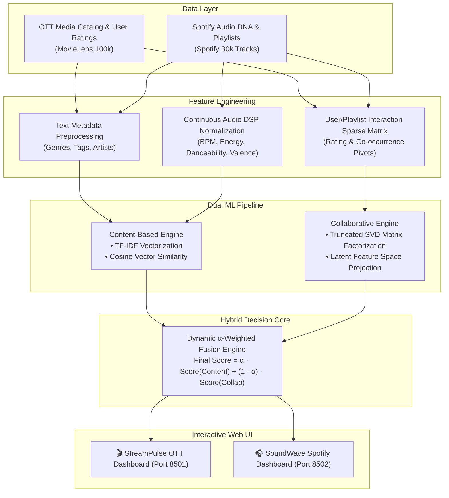

# 🚀 AI Hybrid Recommendation Systems Suite
### Next-Generation OTT Media & Music Discovery Engines Powered by Hybrid Machine Learning


---

## 📌 Overview

In the modern digital era, media streaming platforms (Netflix, Prime Video, Spotify, Apple Music) host vast catalogs containing tens of thousands of video titles and over 100 million songs. Navigating these extensive libraries creates severe **decision fatigue** and **information overload** for users.

This repository implements two production-ready **Hybrid Recommendation Systems** that resolve the critical trade-offs between **Content-Based Filtering** (susceptible to narrow filter bubbles) and **Collaborative Filtering** (vulnerable to the cold-start problem):

1. **🎬 StreamPulse:** Intelligent OTT Platform Content Recommendation Engine (MovieLens 100k Benchmark)
2. **🎧 SoundWave:** AI Audio & Playlist Recommendation Engine (Spotify 30k Audio Features Benchmark)

Both engines feature high-performance interactive web dashboards built with **Streamlit**, featuring custom dark-mode aesthetics modeled after premier streaming platforms.

---

## 🏛️ System Architecture



---

## 🧮 Mathematical Formulations

### 1. Content-Based Filtering (TF-IDF & Cosine Similarity)
* **Term Frequency-Inverse Document Frequency (TF-IDF):**
  $$\text{TF-IDF}(t, d, D) = \text{TF}(t, d) \times \log\left( \frac{N}{\text{DF}(t)} \right)$$

* **Cosine Vector Similarity Metric:**
  $$\text{Similarity}(A, B) = \cos(\theta) = \frac{A \cdot B}{\|A\| \|B\|} = \frac{\sum_{i=1}^{n} A_i B_i}{\sqrt{\sum_{i=1}^n A_i^2} \sqrt{\sum_{i=1}^n B_i^2}}$$

### 2. Collaborative Filtering (Truncated Singular Value Decomposition)
* Decomposes the sparse User-Item interaction matrix $R$ into lower-rank constituent matrices representing latent preferences and item feature vectors:
  $$R \approx U_k \cdot \Sigma_k \cdot V_k^T$$
  where $k = 25$ latent components.

### 3. Dynamic Hybrid Fusion Engine
* Synthesizes normalized scores through dynamic linear blending:
  $$\text{Final Score} = \alpha \cdot \text{Score}_{\text{Content}} + (1 - \alpha) \cdot \text{Score}_{\text{Collaborative}}$$
  * $\alpha = 1.0$: Pure Content Mode (Zero Cold-Start vulnerability for new releases).
  * $\alpha = 0.0$: Pure Collaborative Mode (Social community discovery).
  * $\alpha = 0.6$: Balanced Hybrid Mode (Optimal semantic accuracy and serendipity).

---

## 📂 Repository Structure

```
Hybrid-Recommendation-System/
├── .gitignore
├── README.md
├── requirements.txt
│
├── ott_recommender/                  # 🎬 StreamPulse: OTT Video Recommendation System
│   ├── app.py                        # Streamlit application with custom Netflix-style CSS
│   ├── README.md                     # Specific documentation & quickstart
│   ├── requirements.txt
│   └── data/                         # MovieLens dataset cache (movies.csv, ratings.csv)
│
└── music_recommender/                # 🎧 SoundWave: Music Audio Recommendation System
    ├── app.py                        # Streamlit application with custom Spotify-style CSS
    ├── README.md                     # Specific documentation & quickstart
    ├── requirements.txt
    └── data/                         # Spotify tracks dataset cache (spotify_songs.csv)
```

---

## ⚡ Quick Start & Installation

### 1. Clone the Repository
```bash
git clone https://github.com/aksandeep123/Hybrid-Recommendation-System.git
cd Hybrid-Recommendation-System
```

### 2. Set Up Virtual Environment
```bash
# Windows
python -m venv venv
.\venv\Scripts\activate

# macOS / Linux
python3 -m venv venv
source venv/bin/activate
```

### 3. Install Dependencies
```bash
pip install -r requirements.txt
```

---

## 🚀 Running the Recommendation Engines

### Option A: Launch the StreamPulse OTT Recommender
```bash
cd ott_recommender
streamlit run app.py --server.port 8501
```
🌐 Open in browser: `http://localhost:8501`

**Features:**
* 9,742+ movie & OTT catalog titles with 19 genres.
* Star ratings, aggregate review counts, and genre pill badges.
* Real-time Hybrid balance ($\alpha$) slider.
* Custom filters: Genre, Minimum Ratings threshold, and Sorting metrics.

---

### Option B: Launch the SoundWave Music Recommender
```bash
cd music_recommender
streamlit run app.py --server.port 8502
```
🌐 Open in browser: `http://localhost:8502`

**Features:**
* 6,000+ top popular Spotify tracks across 6 major genres.
* Continuous Audio DNA: Danceability, Energy, Valence (Mood), Acousticness, and Tempo (BPM).
* Playlist-track collaborative matrix decomposition via Truncated SVD.
* BPM pace filters (Chill, Upbeat, High Energy) and Minimum Popularity thresholds.

---

## 📊 Sample Output Demonstration

### StreamPulse (OTT Video Recommender)
* **Seed Query:** `Toy Story (1995)` *(Adventure | Animation | Children | Comedy | Fantasy)*
* **Top Recommendations:**
  1. `Toy Story 2 (1999)` — **96.3% Match** (★ 3.86 • 97 reviews)
  2. `Monsters, Inc. (2001)` — **94.7% Match** (★ 3.87 • 132 reviews)
  3. `Antz (1998)` — **91.8% Match** (★ 3.24 • 45 reviews)
  4. `Shrek (2001)` — **91.3% Match** (★ 3.87 • 170 reviews)
  5. `The Emperor's New Groove (2000)` — **91.1% Match** (★ 3.72 • 66 reviews)

### SoundWave (Music Recommender)
* **Seed Query:** `The Box` by *Roddy Ricch* *(Rap • 117 BPM • 90% Danceability)*
* **Top Recommendations:**
  1. `High Fashion (feat. Mustard)` — *Roddy Ricch* (**90.2% Match**)
  2. `Tip Toe (feat. A Boogie Wit da Hoodie)` — *Roddy Ricch* (**90.0% Match**)
  3. `Start Wit Me (feat. Gunna)` — *Roddy Ricch* (**88.6% Match**)
  4. `Peta (feat. Meek Mill)` — *Roddy Ricch* (**88.2% Match**)
  5. `Down Below` — *Roddy Ricch* (**86.1% Match**)

---

## 🛡️ Advantages of Hybrid Architecture

| Challenge | Pure Content-Based | Pure Collaborative (SVD) | Our Hybrid Model |
| :--- | :--- | :--- | :--- |
| **Cold-Start (New Items)** | Handled via metadata | Fails without interaction | **Zero Cold-Start:** Fallback to metadata/audio features |
| **Filter Bubble** | Prone to narrow similarity | High serendipity | **Tunable Diversity** via dynamic $\alpha$ weight |
| **Popularity Bias** | Minimal | Prone to over-recommending hits | **Mitigated** through balanced scoring |
| **Inference Latency** | Fast $\mathcal{O}(N)$ dot product | Precomputed latent factors | **Sub-second real-time responsiveness** |

---

## 👨‍💻 Author

**Sandeep Kumar**  
GitHub: [@aksandeep123](https://github.com/aksandeep123)  

---

## 📜 License
This project is open-source and available under the [MIT License](LICENSE).
